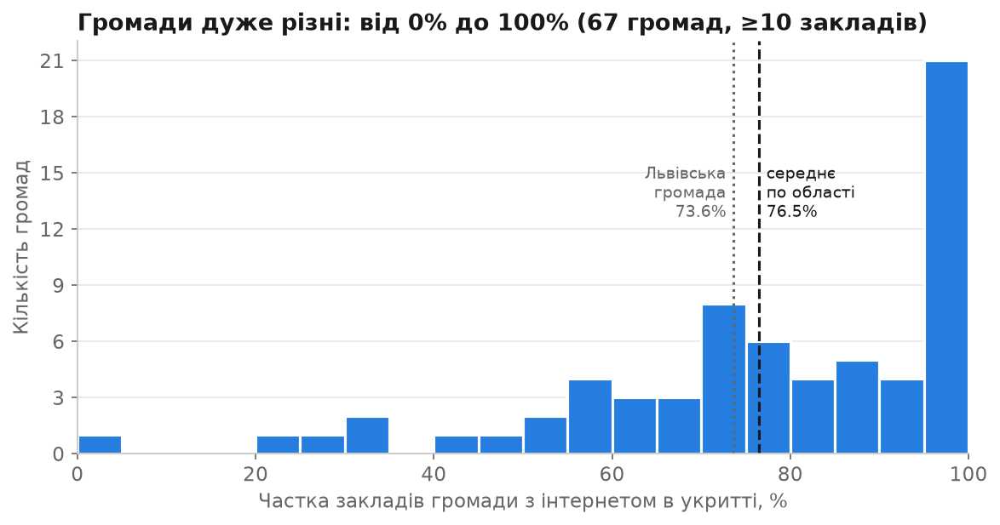
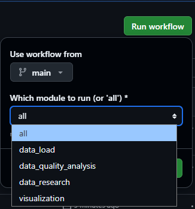
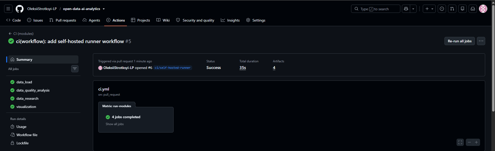
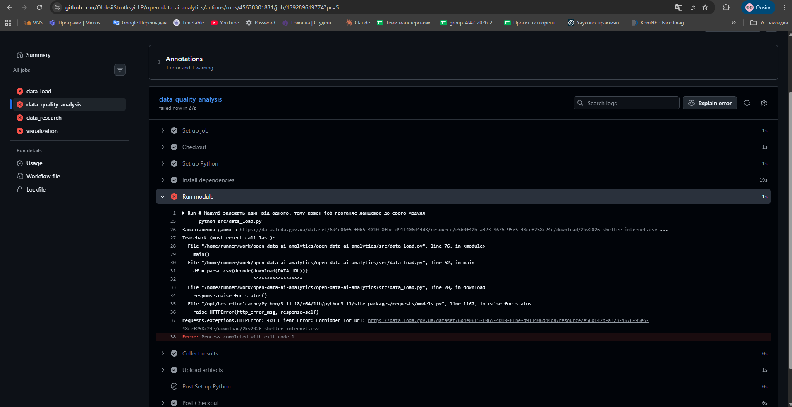
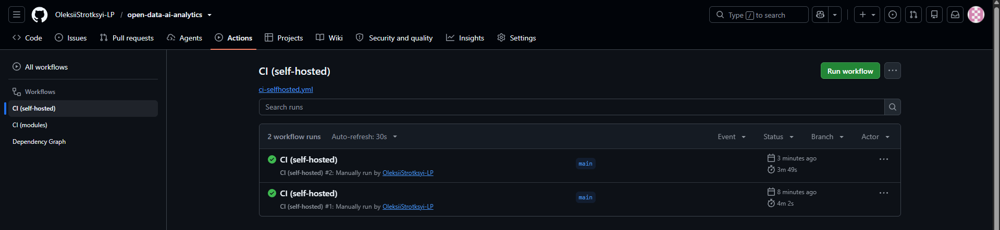
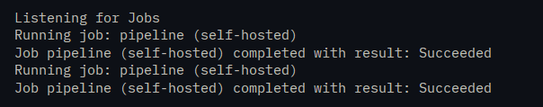
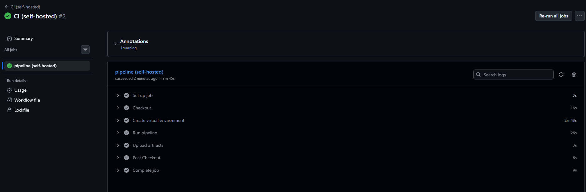

# Звіт до лабораторних робіт

**Проєкт:** аналіз забезпеченості закладів освіти Львівської області укриттями та доступом до інтернету в них.

**Репозиторій:** https://github.com/OleksiiStrotksyi-LP/open-data-ai-analytics

## Лабораторна робота №1. Використання системи контролю версій Git

### 1. Мета

Пройти повний цикл роботи з відкритими даними (завантаження, перевірка якості, дослідження, візуалізація)
і при цьому відпрацювати професійний Git-процес: окрема feature-гілка для кожного модуля, злиття через
Pull Request, розв'язання merge-конфлікту, CHANGELOG і тег версії.

### 2. Дані

- **Набір:** «Забезпеченість укриттями закладів освіти та наявність в них доступу до мережі інтернет»,
  Департамент освіти і науки Львівської ОДА: https://data.loda.gov.ua/dataset/5e122bf0-9932-4226-9fb8-ccf07876f221
- **Обсяг:** 2057 закладів освіти, 73 територіальні громади, 11 полів.
- **Формат:** CSV у кодуванні Windows-1251 з роздільником `;`.
- Дані взято з Місцевого порталу відкритих даних Львівщини, бо портал data.gov.ua під час виконання роботи
  був недоступний через технічні роботи.

### 3. Модулі проєкту

| Модуль | Що робить | Результат |
| --- | --- | --- |
| `src/data_load.py` | Завантажує CSV, сам визначає кодування та роздільник | `data/raw/dataset.csv` (UTF-8) |
| `src/data_quality_analysis.py` | Друкує звіт про якість даних і очищує їх | `data/processed/dataset_clean.csv` |
| `src/data_research.py` | Перевіряє три гіпотези, будує модель логістичної регресії | Звіт у консолі |
| `src/visualization.py` | Будує графіки для кожної гіпотези | `reports/figures/*.png` |

Спільні налаштування (посилання на дані, шляхи до файлів) винесено в `src/config.py`.
Код редагувався в Zed, скрипти запускались у вбудованому терміналі у віртуальному середовищі `.venv`.

### 4. Перевірка якості даних

Знайдені проблеми:

- **Пропуски:** тип укриття (39), доступ до інтернету (6), Wi-Fi (11), швидкість (196), коди ЄДРПОУ / ЄДЕБО / ІСУО (6 / 54 / 3).
- **Різне написання одного значення:** форма власності `приватна` (37) і `Приватна` (35), `комунальна` (1);
  відповідь `так ` із пробілом у кінці (3); укриття `немає` (3) і `відсутнє` (13).
- **Некоректні відповіді:** `1-так. 2-ні`, `1/так, 2/ні`, `1- так, 2- ні` замість «так» або «ні» (шаблон анкети замість відповіді).
- **Тип закладу:** 13 різних варіантів написання, серед них 5 ліквідованих або реорганізованих закладів.
- **Суперечності:** у 43 записах інтернету в укритті немає, але швидкість більша за нуль.
- **Дублікати:** повних дублікатів немає. 149 однакових назв у межах громади виявились школою та її дошкільним
  підрозділом, тобто це різні записи.

Що зроблено під час очищення:

- прибрано зайві пробіли, уніфіковано написання форми власності та типу укриття;
- некоректні відповіді та пропуски в категоріальних полях замінено на `не вказано`;
- видалено 5 ліквідованих / реорганізованих закладів;
- 13 варіантів типу закладу зведено до трьох у новій колонці `InstitutionKind`: школа (1103), дошкільний заклад (881), позашкільний заклад (68);
- швидкість перетворено на число; там, де інтернету немає, а швидкість не вказана, поставлено 0;
- пропуски в кодах закладів лишено як є: це ідентифікатори, і вигадувати їх не можна;
- 43 суперечливі записи лишено без змін, бо невідомо, яке з двох полів хибне.

Після очищення лишилось **2052 заклади**.

### 5. Результати перевірки гіпотез

#### Гіпотеза 1: у школах інтернет в укриттях є частіше — **підтверджується**

Інтернет в укритті мають 81,2% шкіл, 71,6% дошкільних і 63,2% позашкільних закладів.
Укриття є майже в усіх закладах; власне укриття мають 58–63% закладів кожного типу, орендоване — 29–35%.

#### Гіпотеза 2: розрив між громадами значний, а Львівська громада вища за середнє — **підтверджується частково**

Серед 67 громад, де щонайменше 10 закладів, частка укриттів з інтернетом коливається від 0% до 100%
(медіана 80%). У 20 громадах інтернет є в усіх укриттях, у 7 громадах — менше ніж у половині.
Тобто розрив справді великий. Але Львівська громада (73,6%) трохи **нижча** за середнє по області (76,5%),
тож друга частина гіпотези не підтвердилась.

#### Гіпотеза 3: у приватних закладах і в укриттях з Wi-Fi швидкість вища — **підтверджується**

Середня швидкість інтернету в укритті: приватні заклади — 94,8 Мбіт/с (71 заклад), комунальні — 62,7 Мбіт/с
(1949), державні — 28,4 Мбіт/с (лише 5 закладів, тому висновків щодо них не робимо).
В укриттях з Wi-Fi — 80,5 Мбіт/с, з частковим Wi-Fi — 62,1, без Wi-Fi — 5,6.
Різниця між приватними й комунальними закладами лишається й тоді, коли рахувати лише укриття з інтернетом
(100,4 проти 80,3 Мбіт/с).

### 6. Модель

Логістична регресія прогнозує, чи буде в укритті інтернет. Ознаки: тип закладу, форма власності, тип укриття
і розмір громади (кількість закладів у ній). Wi-Fi і швидкість навмисно не використано, бо вони прямо
залежать від наявності інтернету.

- навчальна вибірка — 1530 закладів, тестова — 510;
- accuracy моделі — 0,808, а прогноз «завжди так» дає 0,769;
- ROC AUC — 0,828 (0,5 означає випадкове вгадування).

Найсильніше на шанс мати інтернет впливає тип укриття: відсутнє (коефіцієнт −3,20) та орендоване (−2,22)
укриття помітно знижують шанс порівняно з власним. Приватна форма власності (+1,02) і тип «школа» (+0,82)
його підвищують. Отже, модель підтверджує висновки гіпотез 1 і 3 та показує ще один фактор — власне укриття.

### 7. Робота з Git

| Гілка | Що зроблено | Злиття в `main` |
| --- | --- | --- |
| `main` | Структура проєкту, `.gitignore`, README | коміти напряму |
| `feature/data_load` | Завантаження даних | PR #1 |
| `feature/data_quality_analysis` | Перевірка якості та очищення | PR #2 |
| `feature/data_research` | Гіпотези та модель | PR #3, з конфліктом |
| `feature/visualization` | Графіки | PR #4 |

Повідомлення комітів оформлено за Conventional Commits: `feat(<модуль>): ...`, `docs(<розділ>): ...`.
Описи Pull Request'ів містять розділи «What was done» і «How to test».

#### Merge-конфлікт

Гілки `feature/data_quality_analysis` і `feature/data_research` створено від одного коміту `main`.
Кожна з них додала в README секцію «Модулі» зі своїм рядком на тому самому місці.
Після злиття PR #2 у `main` GitHub показав для PR #3 конфлікт у `README.md`:

Конфлікт розв'язано у вебредакторі GitHub: залишено обидва рядки, маркери `<<<<<<<`, `=======`, `>>>>>>>`
видалено. Результат зафіксовано merge-комітом `2cf4dcb Merge branch 'main' into feature/data_research`,
після чого PR #3 злито. Порядок рядків у секції «Модулі» вирівняно під порядок запуску в гілці
`feature/visualization`.

#### Реліз

Зміни версії описано в `CHANGELOG.md`, реліз позначено анотованим тегом `v0.1.0`.
Граф історії (`git log --oneline --graph --decorate --all`) додається до здачі окремо.

### 8. Висновки

- Створено відтворюваний конвеєр з чотирьох модулів: від завантаження відкритих даних до графіків.
- Відкриті дані виявились «брудними»: різне написання одних значень, відповіді-шаблони, суперечливі записи.
  Без модуля перевірки якості результати аналізу були б хибними.
- Інтернет в укриттях є приблизно у трьох з чотирьох закладів, але доступ дуже нерівномірний між громадами.
  Найкраще забезпечені школи та приватні заклади, а ключовий фактор — власне укриття.
- На практиці відпрацьовано Git-процес: feature-гілки, Pull Request'и, розв'язання конфлікту, CHANGELOG і тегування версії.

---

## Лабораторна робота №2. Побудова CI-конвеєра з GitHub Actions

### 1. Мета

Налаштувати CI для модулів проєкту в GitHub Actions, публікувати результати кожного запуску як артефакти,
запустити конвеєр на власному комп'ютері (self-hosted runner) і порівняти його з хмарою GitHub.

### 2. Що додано в репозиторій

| Файл | Призначення |
| --- | --- |
| `.github/workflows/ci.yml` | CI у хмарі GitHub: чотири модулі паралельно, артефакти після кожного запуску |
| `.github/workflows/ci-selfhosted.yml` | Повний конвеєр на локальному ПК (self-hosted runner) |
| `data/fallback/dataset.csv` | Резервна копія набору даних для хмарного CI |
| `src/data_load.py`, `src/config.py` | Перехід на резервну копію, якщо портал недоступний і ввімкнено `DATA_LOAD_FALLBACK=1` |
| `.gitignore` | Ігнорування локальної папки `artifacts/` |

### 3. Частина A: CI у хмарі GitHub (`ci.yml`)

- **Тригери:** push у `main`, Pull Request у `main` і ручний запуск (`workflow_dispatch`) з вибором модуля
  у випадному списку: `all` або один з чотирьох.
- **Паралельність:** матриця з чотирьох модулів, `fail-fast: false`, тож результат видно по кожному модулю.
  При ручному запуску з конкретним модулем матриця складається лише з нього: список формується виразом
  `fromJSON(...)` прямо в матриці. Варіант із `if:` на рівні job, як у шаблоні методички, не працює,
  бо на цьому рівні контекст `matrix` ще недоступний.
- **Кроки кожного job:** checkout → Python 3.11 з кешем pip → встановлення залежностей → запуск модуля →
  збір результатів → завантаження артефактів.
- **Залежності між модулями:** кожен job виконується на окремій чистій машині, тому проганяє ланцюжок до свого
  модуля. Наприклад, `visualization` = `data_load` → `data_quality_analysis` → `visualization`.
- **Безпека:** `permissions: contents: read`; назва модуля передається в скрипт через змінну середовища,
  а не вставляється в код.

Ручний запуск з вибором модуля:

Успішний запуск у Pull Request: 4 jobs, 35 с, 4 артефакти:

### 4. Частина B: публікація результатів

Обрано варіант 1: результати кожного модуля завантажуються як GitHub Actions artifacts
(`artifacts-<модуль>`, зберігаються 14 днів). В архіві `run.log` з повним виводом модуля і його результат:
сирий CSV (`data_load`), очищений CSV (`data_quality_analysis`) або чотири PNG-графіки (`visualization`).
Кроки збору й завантаження мають `if: always()`, тому лог доступний навіть тоді, коли модуль упав.

### 5. Проблема: портал блокує сервери GitHub

Перший запуск CI впав у всіх чотирьох jobs: портал відкритих даних повертав `403 Forbidden` на запит
`data_load`. З локального ПК той самий скрипт завантажує файл без помилок, отже портал блокує саме
адреси хмарних серверів.

Рішення: у репозиторій додано резервну копію набору (`data/fallback/dataset.csv`, 577 KB).
`data_load` переходить на неї лише тоді, коли завантаження не вдалося **і** ввімкнено змінну
`DATA_LOAD_FALLBACK=1`. Її задає тільки `ci.yml`, тож локально скрипт, як і раніше, завжди качає дані
з порталу. Спроба завантаження та причина переходу на копію фіксуються в лозі як попередження
(GitHub Annotations).

### 6. Частина C: self-hosted runner (`ci-selfhosted.yml`)

- Runner встановлено на ПК з Windows у папку `C:\actions-runner`, мітки: `self-hosted`, `Windows`, `X64`, `local`.
  Він запускається вручну (`run.cmd`) лише на час роботи, а не як служба Windows.
- Workflow запускається **тільки вручну**: репозиторій публічний, тож автоматичний запуск на ПК означав би
  виконання будь-якого коду з Pull Request'ів.
- Для кожного запуску створюється окреме віртуальне середовище в робочій папці runner'а, тож глобальний
  Python не засмічується.
- Модулі запускаються Python-скриптом (`shell: python`), а не командами PowerShell, щоб кирилиця в лозі
  відображалась коректно.
- `data_load` качає дані з порталу напряму, без резервної копії: з українського IP портал доступний.
- Результати (лог, обидва CSV, чотири графіки) завантажуються як артефакт `artifacts-selfhosted`.

Два ручні запуски на ПК:

Консоль runner'а:

Тривалість кроків другого запуску:

### 7. Порівняння GitHub-hosted і self-hosted

| Критерій | GitHub-hosted (хмара) | Self-hosted (локальний ПК) |
| --- | --- | --- |
| Тривалість повного конвеєра | ≈35 с (4 jobs паралельно) | 4 хв 02 с — перший запуск, 3 хв 49 с — другий |
| Встановлення залежностей | ≈20 с у кожному job | 2 хв 48 с |
| Виконання модулів | паралельно, кожен job — свій ланцюжок | 26 с, усі 4 модулі послідовно |
| Доступ до порталу даних | `403 Forbidden`, працює лише з резервною копією | дані завантажуються напряму |
| Середовище | щоразу нова чиста машина Linux | спільний ПК з Windows, залежить від установленого Python |
| Доступність | завжди | лише коли ПК увімкнений і запущено `run.cmd` |

**Швидкість.** Попри очікування, ПК виявився приблизно у 7 разів повільнішим. З 3 хв 45 с роботи job
2 хв 48 с (≈75%) іде на створення віртуального середовища та встановлення бібліотек, а самі модулі
виконуються за 26 с. Повторний запуск швидший лише на 13 с: pip бере пакети з локального кешу, але все одно
розпаковує та встановлює їх у нове середовище, а на Windows це повільно (кожен файл перевіряє антивірус).
Checkout на ПК також довший (16 с проти ≈1 с у хмарі). Прискорити self-hosted можна, якщо не створювати
середовище щоразу, а зберігати його між запусками: постійний диск — перевага локального runner'а, але тоді
середовище перестає бути «чистим», і результат може залежати від попередніх запусків.

**Доступ до локальних ресурсів.** Self-hosted runner має доступ до всього, що бачить ПК: регіональних
сервісів, доступних лише з українських IP (як портал відкритих даних), локальних дисків з великими наборами
даних, внутрішньої мережі. Хмарний runner бачить тільки інтернет і вміст репозиторію, тому для нього
довелося додати резервну копію даних.

**Ризики self-hosted runner'а:**
- *Безпека.* Runner виконує код з репозиторію на ПК з правами користувача. Для публічного репозиторію це
  небезпечно: Pull Request із форка може змінити workflow і запустити довільний код. Заходи: лише ручний
  запуск, у налаштуваннях репозиторію ввімкнено обов'язкове схвалення workflow для зовнішніх учасників,
  `permissions: contents: read`, runner працює лише під час роботи.
- *Стабільність.* Якщо ПК вимкнений або `run.cmd` не запущено, job чекає в черзі
  («Waiting for a runner to pick up this job»), і конвеєр не виконується.
- *Підтримка.* Python, залежності та оновлення самого runner'а — відповідальність власника ПК; результат
  залежить від стану локальної машини.

### 8. Висновки

- Налаштовано CI на GitHub Actions: при кожному push і Pull Request у `main` чотири модулі виконуються
  паралельно, а результати зберігаються як артефакти. Доступний ручний запуск окремого модуля.
- Хмарний runner швидкий, ізольований і не потребує підтримки, але не має доступу до ресурсів, які обмежують
  доступ за географією, тож довелося додати резервну копію даних.
- Self-hosted runner дає доступ до локальних даних і мережі, проте в цій конфігурації повільніший (≈3 хв 50 с
  проти ≈35 с) і несе ризики безпеки, тому запускається лише вручну.
- Практичний підхід: хмарний CI перевіряє кожну зміну, а self-hosted runner вручну проганяє конвеєр на
  справжніх даних з порталу.
