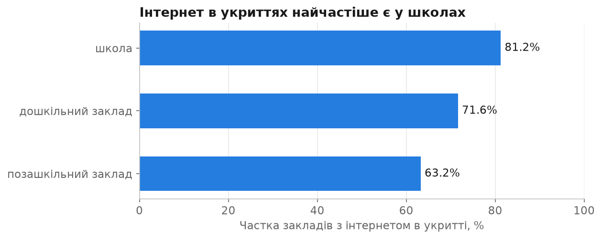
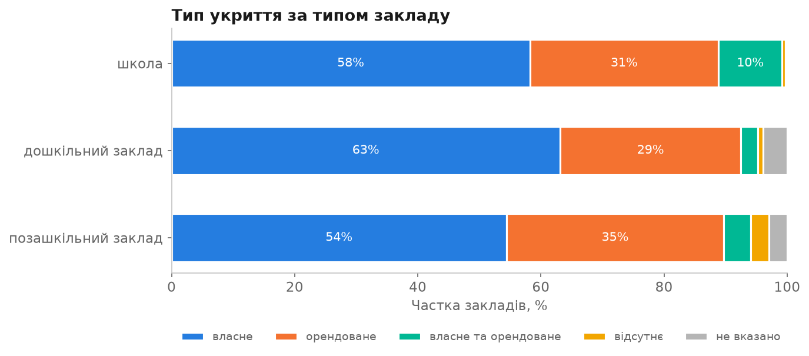
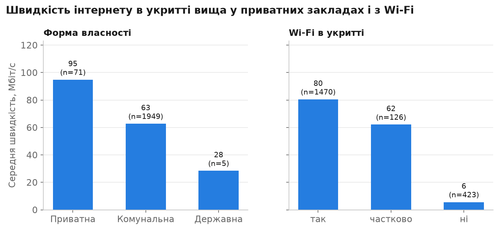
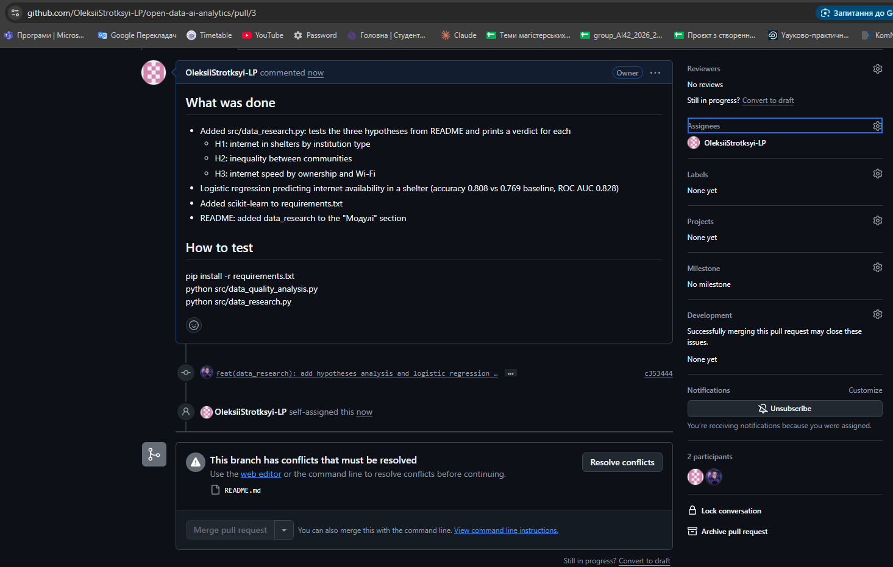

# Звіт до лабораторної роботи №1

**Тема:** Використання системи контролю версій Git

**Проєкт:** аналіз забезпеченості закладів освіти Львівської області укриттями та доступом до інтернету в них.

**Репозиторій:** https://github.com/OleksiiStrotksyi-LP/open-data-ai-analytics

## 1. Мета

Пройти повний цикл роботи з відкритими даними (завантаження, перевірка якості, дослідження, візуалізація)
і при цьому відпрацювати професійний Git-процес: окрема feature-гілка для кожного модуля, злиття через
Pull Request, розв'язання merge-конфлікту, CHANGELOG і тег версії.

## 2. Дані

- **Набір:** «Забезпеченість укриттями закладів освіти та наявність в них доступу до мережі інтернет»,
  Департамент освіти і науки Львівської ОДА: https://data.loda.gov.ua/dataset/5e122bf0-9932-4226-9fb8-ccf07876f221
- **Обсяг:** 2057 закладів освіти, 73 територіальні громади, 11 полів.
- **Формат:** CSV у кодуванні Windows-1251 з роздільником `;`.
- Дані взято з Місцевого порталу відкритих даних Львівщини, бо портал data.gov.ua під час виконання роботи
  був недоступний через технічні роботи.

## 3. Модулі проєкту

| Модуль | Що робить | Результат |
| --- | --- | --- |
| `src/data_load.py` | Завантажує CSV, сам визначає кодування та роздільник | `data/raw/dataset.csv` (UTF-8) |
| `src/data_quality_analysis.py` | Друкує звіт про якість даних і очищує їх | `data/processed/dataset_clean.csv` |
| `src/data_research.py` | Перевіряє три гіпотези, будує модель логістичної регресії | Звіт у консолі |
| `src/visualization.py` | Будує графіки для кожної гіпотези | `reports/figures/*.png` |

Спільні налаштування (посилання на дані, шляхи до файлів) винесено в `src/config.py`.
Код редагувався в Zed, скрипти запускались у вбудованому терміналі у віртуальному середовищі `.venv`.

## 4. Перевірка якості даних

Знайдені проблеми:

- **Пропуски:** тип укриття (39), доступ до інтернету (6), Wi-Fi (11), швидкість (196), коди ЄДРПОУ / ЄДЕБО / ІСУО (6 / 54 / 3).
- **Різне написання одного значення:** форма власності `приватна` (37) і `Приватна` (35), `комунальна` (1);
  відповідь `так ` із пробілом у кінці (3); укриття `немає` (3) і `відсутнє` (13).
- **Некоректні відповіді:** `1-так. 2-ні`, `1/так, 2/ні`, `1- так, 2- ні` замість «так» або «ні» (шаблон анкети замість відповіді).
- **Тип закладу:** 13 різних варіантів написання, серед них 5 ліквідованих або реорганізованих закладів.
- **Суперечності:** у 43 записах інтернету в укритті немає, але швидкість більша за нуль.
- **Дублікати:** повних дублікатів немає. 149 однакових назв у межах громади виявились школою та її дошкільним
  підрозділом, тобто це різні записи.

Що зроблено під час очищення:

- прибрано зайві пробіли, уніфіковано написання форми власності та типу укриття;
- некоректні відповіді та пропуски в категоріальних полях замінено на `не вказано`;
- видалено 5 ліквідованих / реорганізованих закладів;
- 13 варіантів типу закладу зведено до трьох у новій колонці `InstitutionKind`: школа (1103), дошкільний заклад (881), позашкільний заклад (68);
- швидкість перетворено на число; там, де інтернету немає, а швидкість не вказана, поставлено 0;
- пропуски в кодах закладів лишено як є: це ідентифікатори, і вигадувати їх не можна;
- 43 суперечливі записи лишено без змін, бо невідомо, яке з двох полів хибне.

Після очищення лишилось **2052 заклади**.

## 5. Результати перевірки гіпотез

### Гіпотеза 1: у школах інтернет в укриттях є частіше — **підтверджується**

Інтернет в укритті мають 81,2% шкіл, 71,6% дошкільних і 63,2% позашкільних закладів.
Укриття є майже в усіх закладах; власне укриття мають 58–63% закладів кожного типу, орендоване — 29–35%.

### Гіпотеза 2: розрив між громадами значний, а Львівська громада вища за середнє — **підтверджується частково**

Серед 67 громад, де щонайменше 10 закладів, частка укриттів з інтернетом коливається від 0% до 100%
(медіана 80%). У 20 громадах інтернет є в усіх укриттях, у 7 громадах — менше ніж у половині.
Тобто розрив справді великий. Але Львівська громада (73,6%) трохи **нижча** за середнє по області (76,5%),
тож друга частина гіпотези не підтвердилась.

### Гіпотеза 3: у приватних закладах і в укриттях з Wi-Fi швидкість вища — **підтверджується**

Середня швидкість інтернету в укритті: приватні заклади — 94,8 Мбіт/с (71 заклад), комунальні — 62,7 Мбіт/с
(1949), державні — 28,4 Мбіт/с (лише 5 закладів, тому висновків щодо них не робимо).
В укриттях з Wi-Fi — 80,5 Мбіт/с, з частковим Wi-Fi — 62,1, без Wi-Fi — 5,6.
Різниця між приватними й комунальними закладами лишається й тоді, коли рахувати лише укриття з інтернетом
(100,4 проти 80,3 Мбіт/с).

## 6. Модель

Логістична регресія прогнозує, чи буде в укритті інтернет. Ознаки: тип закладу, форма власності, тип укриття
і розмір громади (кількість закладів у ній). Wi-Fi і швидкість навмисно не використано, бо вони прямо
залежать від наявності інтернету.

- навчальна вибірка — 1530 закладів, тестова — 510;
- accuracy моделі — 0,808, а прогноз «завжди так» дає 0,769;
- ROC AUC — 0,828 (0,5 означає випадкове вгадування).

Найсильніше на шанс мати інтернет впливає тип укриття: відсутнє (коефіцієнт −3,20) та орендоване (−2,22)
укриття помітно знижують шанс порівняно з власним. Приватна форма власності (+1,02) і тип «школа» (+0,82)
його підвищують. Отже, модель підтверджує висновки гіпотез 1 і 3 та показує ще один фактор — власне укриття.

## 7. Робота з Git

| Гілка | Що зроблено | Злиття в `main` |
| --- | --- | --- |
| `main` | Структура проєкту, `.gitignore`, README | коміти напряму |
| `feature/data_load` | Завантаження даних | PR #1 |
| `feature/data_quality_analysis` | Перевірка якості та очищення | PR #2 |
| `feature/data_research` | Гіпотези та модель | PR #3, з конфліктом |
| `feature/visualization` | Графіки | PR #4 |

Повідомлення комітів оформлено за Conventional Commits: `feat(<модуль>): ...`, `docs(<розділ>): ...`.
Описи Pull Request'ів містять розділи «What was done» і «How to test».

### Merge-конфлікт

Гілки `feature/data_quality_analysis` і `feature/data_research` створено від одного коміту `main`.
Кожна з них додала в README секцію «Модулі» зі своїм рядком на тому самому місці.
Після злиття PR #2 у `main` GitHub показав для PR #3 конфлікт у `README.md`:

Конфлікт розв'язано у вебредакторі GitHub: залишено обидва рядки, маркери `<<<<<<<`, `=======`, `>>>>>>>`
видалено. Результат зафіксовано merge-комітом `2cf4dcb Merge branch 'main' into feature/data_research`,
після чого PR #3 злито. Порядок рядків у секції «Модулі» вирівняно під порядок запуску в гілці
`feature/visualization`.

### Реліз

Зміни версії описано в `CHANGELOG.md`, реліз позначено анотованим тегом `v0.1.0`.
Граф історії (`git log --oneline --graph --decorate --all`) додається до здачі окремо.

## 8. Висновки

- Створено відтворюваний конвеєр з чотирьох модулів: від завантаження відкритих даних до графіків.
- Відкриті дані виявились «брудними»: різне написання одних значень, відповіді-шаблони, суперечливі записи.
  Без модуля перевірки якості результати аналізу були б хибними.
- Інтернет в укриттях є приблизно у трьох з чотирьох закладів, але доступ дуже нерівномірний між громадами.
  Найкраще забезпечені школи та приватні заклади, а ключовий фактор — власне укриття.
- На практиці відпрацьовано Git-процес: feature-гілки, Pull Request'и, розв'язання конфлікту, CHANGELOG і тегування версії.
